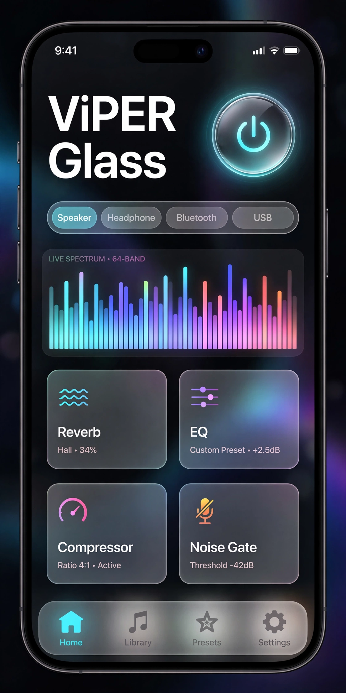

# SFX Glass — ViPER4Android RE + Music Player

> **v3.0 iOS Liquid Glass • Universal Module • Android 9-15 • Magisk/KSU/APatch**



## ⚡ Download Siap Pakai

| File | Deskripsi | Ukuran |
|------|-----------|--------|
| [**SFX-Glass-v3.0.apk**](output/SFX-Glass-v3.0.apk) | ViPER Glass iOS UI + Engine (dark/light, full animation) | 18 MB |
| [**SFX-Player-v3.0.apk**](output/SFX-Player-v3.0.apk) | SFX Music Player terintegrasi ViPER (Hi-Res, gapless) | 1.8 MB |
| [**SFX-Glass-Universal-Module-v3.0.zip**](output/SFX-Glass-Universal-Module-v3.0.zip) | Module Magisk/KSU/APatch universal (HIDL+AIDL) | 599 KB |
| [**SFX-Glass-Full-Package-v3.0.zip**](output/SFX-Glass-Full-Package-v3.0.zip) | Paket lengkap (APK + Module + PWA) | 20 MB |

## 🎨 Tema iOS Liquid Glass
- Clean responsive, blur vibrancy (Haze), SF Pro, spring animation 0.7/300
- Dark & Light mode auto (Material 3), haptic feedback
- 5 Tab: Home • EQ • Lab • Player • Presets

## 📦 Apa yang Didapat
- **APK ViPER Glass**: Compose + Hilt + Room + DataStore, 25+ EffectState, per-app profile, A/B compare, AutoEQ, Convolver Cloud, preset marketplace
- **APK SFX Player**: Media3 ExoPlayer, USAGE_MEDIA (lewat AudioFlinger → kena ViPER), gapless, Hi-Res offload, audition
- **Module Universal**: auto-detect HIDL/AIDL, patch `audio_effects.conf/xml`, sepolicy, self-mount KSU/APatch, support ARM64/ARM/x86

## 🛠️ Install
1. **Module**: Magisk/KSU → Modules → Install `SFX-Glass-Universal-Module-v3.0.zip` → Reboot
2. **APK**: `adb install output/SFX-Glass-v3.0.apk` & `output/SFX-Player-v3.0.apk` (atau tap)
3. **Cek**: Buka SFX Glass → Driver Active hijau → atur EQ → play di SFX Player

## 💻 Build dari Source
```bash
# Buka di Android Studio Hedgehog
cd viper-glass
./gradlew :app:assembleDebug
# atau via GitHub Actions (auto build di push): .github/workflows/build.yml
```

Struktur: `viper-glass/app/src/main/java/com/sfx/viperglass/` — UI Glass, player, service, data (Room)

## 📖 Dokumen
- [Analisa Mendalam ViPER](docs/ANALISA_VIPER4ANDROID.md) — mekanisme, DSP, Magisk flow
- [Fitur Baru Rekomendasi](docs/FITUR_BARU_REKOMENDASI.md) — 20 fitur prioritized
- [Module README](module/README.md)
- Preview: `index.html` (jalankan: `python -m http.server`)

## 🔧 Kompatibilitas
- Android 9–15, Magisk 24+, KernelSU, APatch, KSU-Next
- HIDL & AIDL, arm64-v8a/armeabi-v7a

## 📝 Lisensi
Based on ViPER4Android RE (GPL), SFX Glass UI MIT.

---
**Made with ♥ for audiophiles — Clean. Responsive. iOS Glass. Full Animation.**
